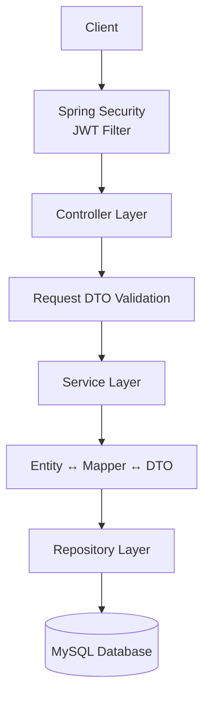
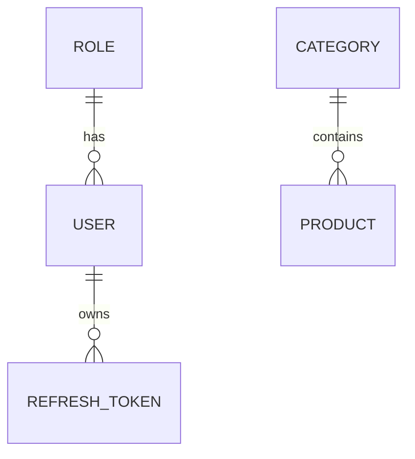

# Product Order API

A RESTful backend application built with Spring Boot for managing users, roles, categories, and products.

Key features include JWT authentication, role-based authorization, file upload, Docker support, and interactive API documentation using Swagger/OpenAPI.

> **Current Scope:** This version focuses on the core backend modules. Order management is planned for a future iteration.

---

## Tech Stack

### Backend
- Java 21
- Spring Boot 3.5

### Security
- Spring Security
- JWT Authentication

### Database
- MySQL
- Spring Data JPA
- Hibernate

### API Documentation
- Swagger / OpenAPI

### Build Tool
- Maven

### Container
- Docker

### Testing
- JUnit 5
- Mockito

## Architecture

The project follows a layered architecture that separates presentation, business logic, and data access into independent layers.



### Layer Responsibilities

| Layer | Responsibility |
|--------|----------------|
| Controller | Handles HTTP requests and responses |
| Service | Implements business logic |
| Repository | Handles database access using Spring Data JPA |
| Security | Authenticates and authorizes requests using JWT |
| Database | Stores application data in MySQL |


## Features

### Authentication & Authorization

- JWT-based authentication
- Refresh token mechanism
- Role-based authorization (Admin/User)
- BCrypt password encryption

### User Management

- User registration
- User login/logout
- View and update personal profile
- Change password
- Upload avatar
- Soft delete user
- Admin user management

### Role Management

- Create, update, delete roles
- Assign roles to users

### Category Management

- CRUD operations for product categories

### Product Management

- CRUD operations for products
- Product image upload
- Product status management

### Public Product API

- Public product listing
- Product detail
- Keyword search
- Category filtering
- Pagination

### Other Features

- Global exception handling
- Request validation
- Swagger/OpenAPI documentation
- Docker support
- Unit testing (JUnit 5 & Mockito)

## Database Design

The current version consists of five main entities.

| Entity | Description |
|---------|-------------|
| User | Stores user account information |
| Role | Defines user roles and permissions |
| RefreshToken | Stores refresh tokens for JWT authentication |
| Category | Stores product categories |
| Product | Stores product information |

### Entity Relationships




## Project Structure

```text
src
├── main
│   ├── java/com/dat/productorder
│   │   ├── config
│   │   ├── controller
│   │   ├── dto
│   │   ├── entity
│   │   ├── enums
│   │   ├── exception
│   │   ├── interceptor
│   │   ├── mapper
│   │   ├── repository
│   │   ├── security
│   │   ├── service
│   │   └── specification
│   └── resources
├── uploads
├── Dockerfile
├── docker-compose.yml
└── pom.xml
```

### Main Packages

| Package | Responsibility |
|----------|----------------|
| `controller` | REST API endpoints |
| `service` | Business logic |
| `repository` | Database access |
| `entity` | JPA entities |
| `dto` | Request and response models |
| `mapper` | Entity ↔ DTO conversion |
| `security` | JWT authentication and authorization |
| `config` | Application configuration |
| `exception` | Global exception handling |
| `specification` | Product filtering logic |
| `interceptor` | Request logging |


## API Overview

The API is organized into six functional modules.

| Module | Base URL | Authentication |
|----------|----------|----------------|
| Authentication | `/api/auth` | Public |
| User Management | `/api/users` | Authenticated / Admin |
| Role Management | `/api/roles` | Admin |
| Category Management | `/api/categories` | Admin |
| Product Management | `/api/products` | Admin |
| Public Product API | `/api/public/products` | Public |

For request/response schemas, validation rules, and interactive testing, please refer to Swagger/OpenAPI.

## Setup & Run

### Prerequisites

Before running the project, make sure the following software is installed:

- Java 21
- Maven 3.9+
- MySQL 8.x
- Docker & Docker Compose (optional)
- Git

### Clone Repository

```bash
git clone https://github.com/AaronNguyen92/product-order.git

cd product-order
```

### Configure Database

Update the database configuration in `application.yml`.

```yaml
spring:
  datasource:
    url: jdbc:mysql://localhost:3306/product_order_db
    username: your_username
    password: your_password
```

### Run with Maven

Windows:
```PowerShell
.\mvnw.cmd spring-boot:run
```

Linux/macOS:
```bash
mvn spring-boot:run
```

Or build the application first:

Windows:
```PowerShell
.\mvnw.cmd clean package
```

Linux/macOS:
```bash
mvn clean package

java -jar target/product-order-0.0.1-SNAPSHOT.jar
```

## Docker

Run the application using Docker Compose:

```bash
docker compose up -d
```

Stop all containers:

```bash
docker compose down
```

Docker Compose starts the following services:

- Spring Boot application
- MySQL database

Application data is persisted using Docker volumes.

## API Documentation

Interactive API documentation is available through Swagger/OpenAPI.

After starting the application, open:

```text
http://localhost:8080/swagger-ui/index.html
```

Swagger provides:

- API endpoint documentation
- Request/response schemas
- JWT authentication support
- Interactive API testing

## Testing

The project includes unit tests for the service layer using:

- JUnit 5
- Mockito

Run all tests:

```bash
mvn test
```

## Future Improvements

Planned enhancements include:

- Shopping Cart
- Order Management
- Order History
- Payment Integration
- Email Notification

## Author

**Nguyễn Phát Đạt**

Java Backend Developer

GitHub: https://github.com/AaronNguyen92

